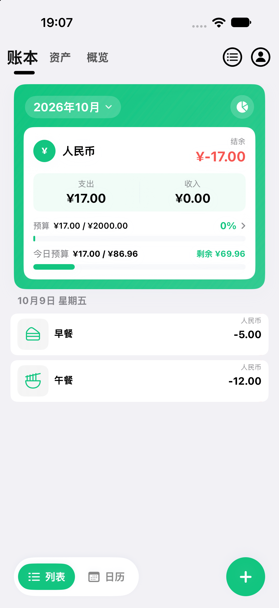
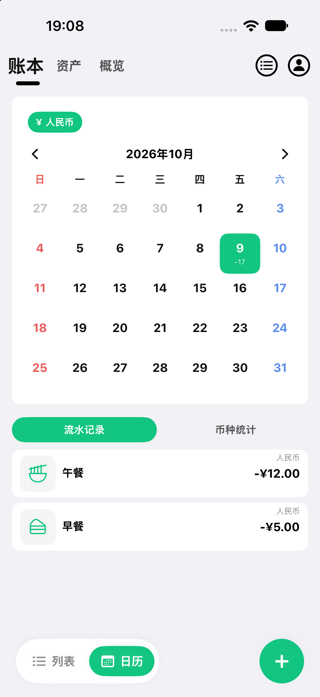
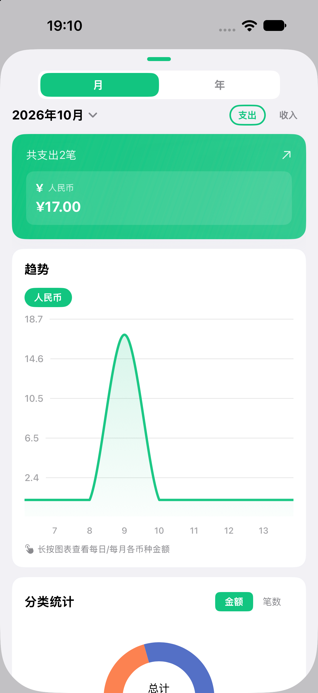
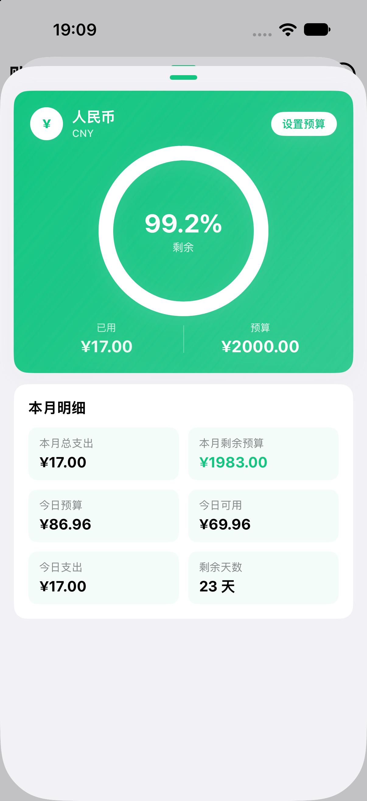
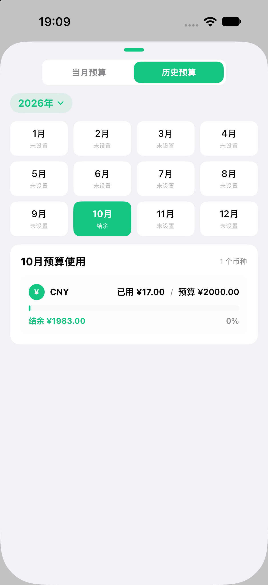
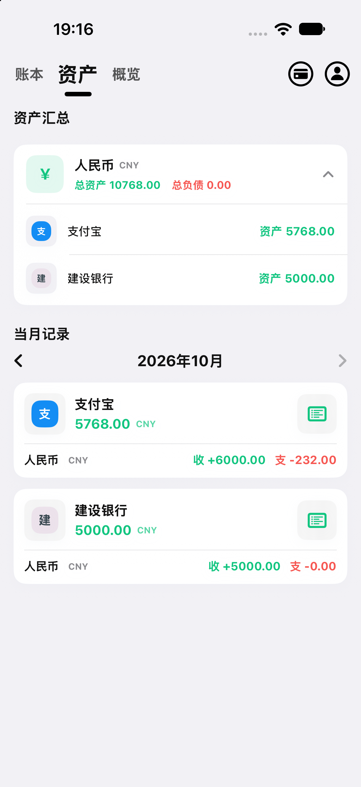
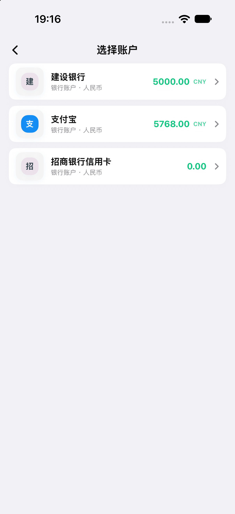
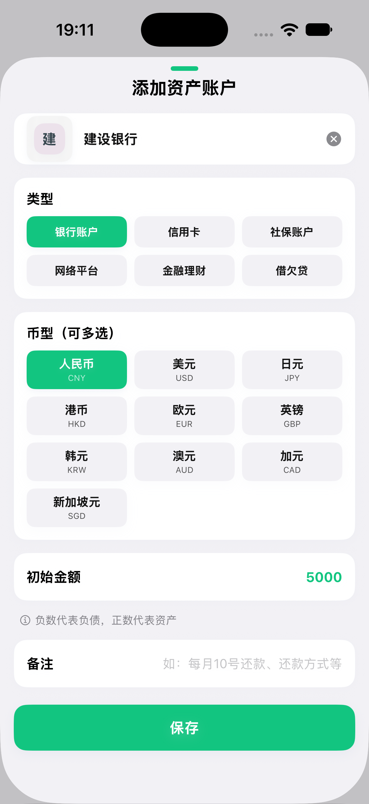
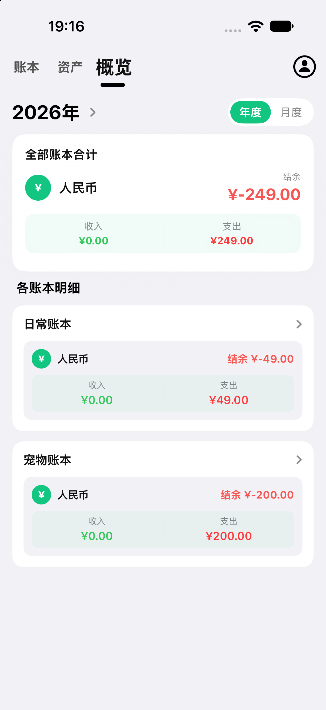
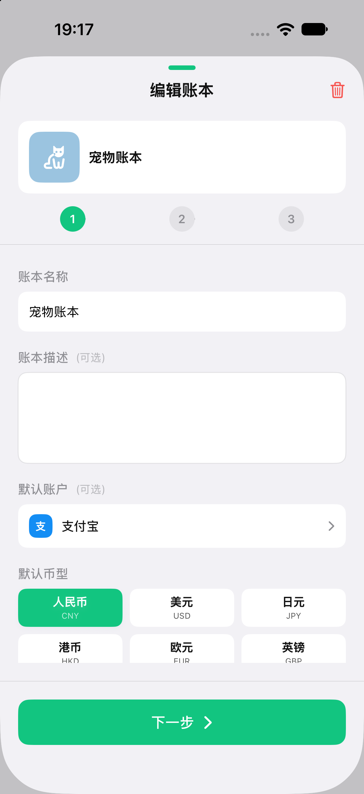

# 青木账本（QingmuAccount）

[中文](README.md) | [English](README_en.md)

一款**完全离线**的 iOS 记账应用，使用 SwiftUI 开发。无网络请求、不依赖 iCloud，所有数据均保存在本机 SQLite 数据库中。支持深色模式、多账本、多币种、预算、统计图表与完整的资产/负债管理。

> 部署目标 iOS 17.6，仅支持 iPhone，Swift 5，**零第三方依赖**。

---

## 截图预览

<table>
  <tr>
    <td align="center"><br><sub>账本首页 · 列表视图</sub></td>
    <td align="center"><br><sub>账本首页 · 日历视图</sub></td>
    <td align="center"><br><sub>统计 · 趋势与分类占比</sub></td>
    <td align="center"><br><sub>当月预算</sub></td>
  </tr>
  <tr>
    <td align="center"><br><sub>历史预算</sub></td>
    <td align="center"><br><sub>资产汇总与当月记录</sub></td>
    <td align="center"><br><sub>选择账户</sub></td>
    <td align="center"><br><sub>添加资产账户</sub></td>
  </tr>
  <tr>
    <td align="center"><br><sub>概览 · 各账本合计</sub></td>
    <td align="center"><br><sub>编辑账本</sub></td>
    <td></td>
    <td></td>
  </tr>
</table>

---

## 功能特性

### 📒 账本管理
- 多账本创建、编辑与切换，每个账本可自定义名称、图标与背景色。
- 每个账本可设置**默认币种**（记账时未选择账户时的兜底币种）。
- 当前选中的账本会持久化保存，下次启动自动恢复。

### ✍️ 记账
- 记录日常**支出 / 收入**，支持日期、金额、分类图标与备注。
- **列表视图**与**日历视图**自由切换，按日查看当日收支。
- 金额以「分」为单位整数存储并聚合，避免浮点误差。

### 💱 多币种
- 支持 **10 种币种**：人民币、美元、日元、港币、欧元、英镑、韩元、澳元、加元、新加坡元。
- 记账、预算、资产账户、余额均携带币种字段。
- 各币种**分开展示，不做汇率折算**。

### 💰 预算
- 按月设置预算（支持分币种）。
- 预算明细页展示每月的预算使用情况与剩余额度。

### 📊 统计
- 月度 / 年度收支统计。
- **饼图**展示分类占比，**多线可滚动折线图**（平滑曲线、渐变填充、长按查看数值）对比多维度数据。

### 🏦 资产与负债
- **6 类账户**：银行账户、信用卡、社保账户、网络平台、金融理财、借欠贷。
- **4 种资产变更**：转入、转出、转移、调账（调账可手动增减）。
- 账户详情、账户编辑、资产记录编辑、按月资产视图、资产汇总、余额轮播等完整页面。
- 内置 **326 个**银行 / 支付平台图标（Apple Pay、支付宝、微信、银联、各大银行等）。

### 📈 概览
- 月 / 年收支总览，快速掌握整体财务状况。

### 🎨 其他
- **深色模式**全局适配。
- 关键操作**触感反馈**。
- 自定义数字键盘，贴近记账场景的输入体验。

---

## 技术架构

项目遵循「视图层 → 组件层 → 服务层（模型 + 文件读写）」的三层结构，`GlobalModel` 作为核心状态容器（`ObservableObject`），通过 `.environmentObject` 注入到各视图。

### 服务模式（关键约定）
每个数据域拆分为两个服务：
- **`XxxService`** — 数据库读写，以 `SQLiteManager` 为底层执行 SQL，抛出领域特定错误枚举。
- **`XxxOfCacheService`** — 视图实际调用的层，先查 `GlobalModel` 缓存，未命中则回退到原始 Service 并写回缓存。

数据聚合查询（概览、统计、预算、日历）统一走 `AccountBookAggregateService`（SQL 聚合）。

### 持久化（SQLite）
- 数据存于 `Documents/account/account.db`（WAL 模式，SQLite3 C API 封装，`libsqlite3.tbd` 已链接）。
- 金额采用**双列**：`money TEXT` 保留展示原文 + `moneyCents INTEGER`（分为单位，聚合基准），聚合一律用 `SUM(moneyCents)`。
- 首次启动自动把旧版 JSON 数据一次性迁移到 SQLite（单事务），旧 JSON 备份到 `Documents/account_backup_<时间戳>/`，迁移幂等。

### 图标
- 图标来自内置自定义字体 `icomoon.ttf`（`Info.plist` 的 `UIAppFonts` 声明）。
- `fonts/IconfontEnum.swift` 将枚举 case 映射到 Unicode 码点；模型中的 `iconStr` 存枚举 `rawValue`。

### 颜色与主题
- 全局复用资源目录中的命名颜色（如 `Color("ViewBackgroundColor")`、`Color("FontColor")`），驱动深色模式适配。

---

## 构建与运行

```bash
xcodebuild -project QingmuAccount.xcodeproj -scheme QingmuAccount \
  -destination 'platform=iOS Simulator,name=iPhone 17' build
```

或在 Xcode 中打开 `QingmuAccount.xcodeproj` 直接运行。

- Bundle ID：`acthat.QingmuAccount`
- 项目无测试 target，验证方式为构建 / 运行。

---

## 关于图标

- 图标字体信息：<https://pan.baidu.com/s/1wpGmW57sJhjsfkaxTbAzrw>（提取码 `bi6b`）
- 图标来源：iconpark（绝大部分）、iconfinder（小部分）、iconfont（极少部分，均为开源可商用）、figma（自制图标）
- 图标字体制作：<https://icomoon.io/>
